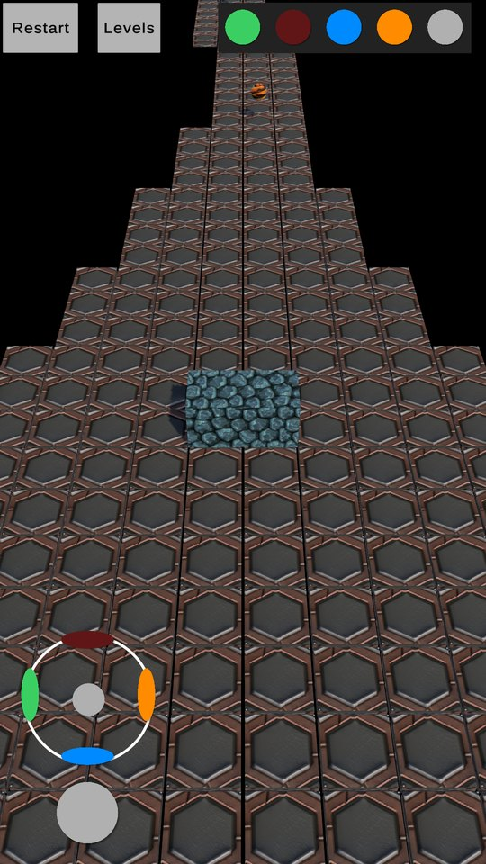
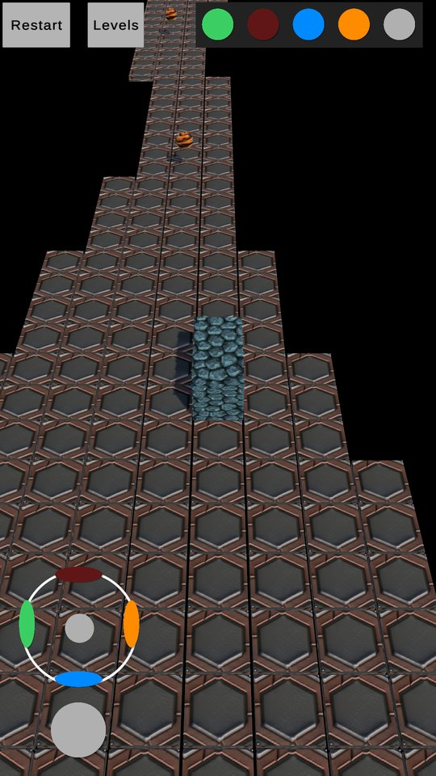
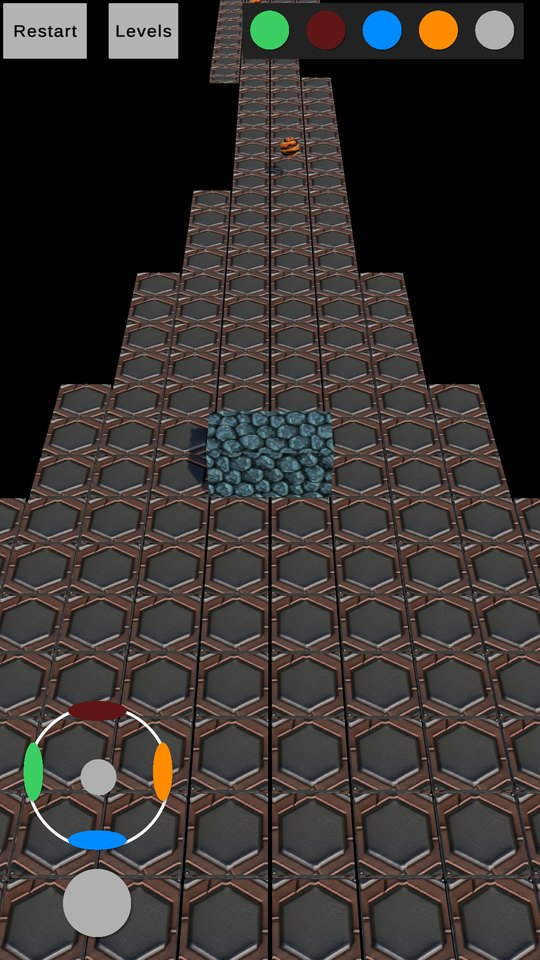

# Block Road

3D puzzle · 08/2025 · Unity · C# · JSON levels

Roll a rectangular block along a road to the goal. The block can switch into one of four elemental forms for a limited time, and obstacles of an element can only be passed in the matching form. Levels are built from sections loaded from JSON.

> More of my projects: **[burak-unye.vercel.app](https://burak-unye.vercel.app)**

| | | |
|:---:|:---:|:---:|
|  |  |  |

## Highlights

- **Block rolling** around the edge it tips over, with standing/lying states detected by four ground triggers, hold-to-repeat moves and a falling/tumbling death (`Scripts/BlockRoller.cs`, `BlockTrigger.cs`).
- **Elemental forms:** a second joystick picks one of four elements (right, left, up, down); each form has its own material, tag and timer bar, and a button returns to the normal form (`Scripts/TransformManager.cs`). Touching an obstacle of another element restarts the level (`DeathManager.cs`).
- **JSON level sections:** `Resources/levels.json` lists prefabs with offsets; sections are spawned ahead of the player and progress is saved (`Scripts/LevelSpawner.cs`).
- Mobile controls (floating joystick) and keyboard (W/A/S/D).

## Opening the project

Unity **6000.0.58f2**. Third-party assets are **not included** (licences and size): Joystick Pack, Game Buffs textures, LowlyPoly and Yughues Free Metal Materials. Import Joystick Pack first so the scripts compile.

---

## Türkçe

Dikdörtgen bloğu yuvarlayarak hedefe ulaştırılan 3D bulmaca. Blok süreli olarak dört element formundan birine geçebilir; bir elementin engelinden yalnız aynı formda geçilir. Bölümler JSON'dan yüklenen parçalardan oluşur. Üçüncü taraf paketler repoya eklenmedi.
